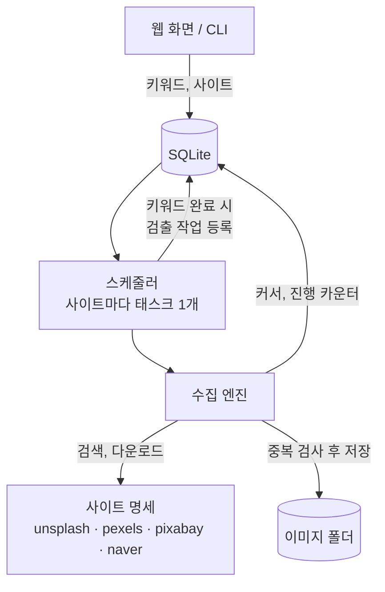

# 이미지 수집기

키워드를 등록해 두면 여러 이미지 사이트에서 사진을 자동으로 모으는 프로그램입니다.
켜 두면 API 한도나 오류를 스스로 기다렸다가 이어서 수집하고, 껐다 켜도 멈춘 자리부터 다시 시작합니다.

수집한 이미지는 이후 오탐 후보 검출 단계의 입력으로 쓸 예정이며, 현재는 **수집 기능**까지 구현되어 있습니다.

## 기능

- **4개 사이트 수집**: Unsplash, Pexels, Pixabay, 네이버 이미지 검색
- **키워드 여러 개 등록**: 쉼표로 구분해 입력하면 입력한 순서대로 수집
- **사이트별 독립 진행**: 한 사이트가 한도에 걸려 쉬는 동안에도 다른 사이트는 다음 키워드로 진행
- **이어받기**: 검색 위치(커서)를 DB에 저장해, 중단하거나 재부팅한 뒤에도 그 자리부터 재개
- **중복 제거 3단계** (사이트와 키워드 전체에 적용)
  - 출처 ID: 이미 본 사진은 내려받지 않음
  - SHA-256: 다른 사이트에 올라온 완전히 같은 파일
  - 지각 해시: 크기를 바꾸거나 다시 압축한 같은 사진 (저장하지 않고 기록만 남김)
- **자동 복구**
  - 네트워크 오류, 429, 5xx: 1→2→4→8초 간격으로 재시도
  - 시간당 API 한도 도달: 남은 시간만큼 대기 후 재개
  - 심각한 오류: 해당 작업만 10분 쉬었다가 재개
  - API 키 오류: 1시간 간격으로 재시도, 3번째에 실패 처리
- **검출 연계**: 키워드 하나를 모든 사이트가 끝내면 검출 작업을 DB에 등록
- **API 연결 확인**: 사이트별로 키가 유효한지 검사
- **진행 화면과 로그**: 웹 화면에서 사이트별 진행률 확인, 파일 로그 기록 (API 키는 가려서 기록)

## 준비

Python 3.12 이상이 필요합니다.

```
python -m venv .venv
.venv\Scripts\python -m pip install -e .[dev]
copy .env.sample .env
```

`.env`를 열어 사용할 사이트의 API 키를 채웁니다. 키를 넣지 않은 사이트는 자동으로 제외됩니다.

| 항목 | 설명 | 기본값 |
|---|---|---|
| `UNSPLASH_API_KEY` | Unsplash Access Key | — |
| `PEXELS_API_KEY` | Pexels API 키 | — |
| `PIXABAY_API_KEY` | Pixabay API 키 | — |
| `NAVER_CLIENT_ID`, `NAVER_CLIENT_SECRET` | 네이버 검색 API (NCP API Gateway) | — |
| `BASE_SAVE_PATH` | 이미지 저장 폴더 | 프로젝트의 `Image` |
| `MAX_DOWNLOADS` | 키워드×사이트 작업 하나에서 새로 받을 최대 장수 | 제한 없음 |
| `REQUEST_TIMEOUT_MS` | 요청 1건당 타임아웃 | 60000 |
| `MAX_RETRIES` | 네트워크 오류 재시도 횟수 | 4 |
| `UNSPLASH_IMAGE_SIZE` | `full` / `raw` / `regular` / `small` | `regular` |
| `PEXELS_IMAGE_SIZE` | `original` / `large2x` / `large` | `large2x` |
| `DB_PATH` | 작업 상태를 저장하는 SQLite 파일 | `data\pipeline.db` |
| `PHASH_THRESHOLD` | 지각 해시가 이 비트 수 이하로 다르면 같은 이미지로 판단 | 5 |

## 실행

### 웹 화면으로

```
.venv\Scripts\python -m app serve
```

브라우저에서 http://127.0.0.1:8000 을 엽니다.

1. 수집할 사이트를 고릅니다. `연결 확인`을 누르면 API 키가 유효한지 알려 줍니다.
2. 키워드를 쉼표로 구분해 입력하고, 필요하면 최대 장수를 적은 뒤 `실행`을 누릅니다.
3. 아래 표에서 키워드별·사이트별 진행 상황을 확인합니다. 3초마다 갱신됩니다.

수집은 서버가 하므로 브라우저를 닫아도 계속됩니다. 서버를 다시 켜면 남아 있던 작업을 자동으로 이어서 합니다.
오른쪽 위 `중단` / `재개` 버튼으로 수집을 잠시 멈출 수 있습니다.

### 명령줄로

| 명령 | 하는 일 |
|---|---|
| `python -m app check` | API 키가 유효한지 확인 |
| `python -m app collect "beach, sunset" --sites pexels,naver --target 50` | 키워드를 등록하고 끝날 때까지 수집 |
| `python -m app resume` | 남은 작업을 이어서 수집 |
| `python -m app status` | 진행 상황 출력 |
| `python -m app serve --port 8000` | 웹 서버 실행 |

명령 앞에 `.venv\Scripts\`를 붙여 실행합니다. `collect`에서 `--sites`를 빼면 키가 설정된 모든 사이트에서,
`--target`을 빼면 `.env`의 `MAX_DOWNLOADS`만큼 받습니다. `Ctrl+C`로 멈춘 뒤 `resume`으로 이어서 할 수 있습니다.

수집기(`serve`, `collect`, `resume`)는 한 번에 하나만 실행할 수 있습니다. 이미 돌고 있으면 두 번째 실행은 거부됩니다.
`check`와 `status`는 수집기가 도는 중에도 실행할 수 있습니다.

### 작업 상태의 의미

| 상태 | 의미 |
|---|---|
| 대기 (`pending`) | 차례를 기다리는 중 |
| 수집 중 (`running`) | 지금 수집하고 있음 |
| 한도 대기 (`rate_limited`) | 시간당 API 한도에 닿아 대기 중. 표시된 시각에 자동 재개 |
| 일시 정지 (`paused`) | 오류로 10분(인증 오류는 1시간) 쉬는 중. 표시된 시각에 자동 재개 |
| 완료 (`done`) | 검색 결과를 끝까지 확인했거나 목표 장수에 도달 |
| 실패 (`failed`) | API 키 오류가 3번 반복됨. 키를 고친 뒤 같은 키워드를 다시 등록하면 재시도 |

끝난 키워드를 다시 등록하면 처음부터 다시 훑어 그사이 새로 올라온 사진만 받습니다.

## 무인 운영 (자동 시작)

PC가 켜지면 서버가 자동으로 시작되고, 비정상 종료되면 다시 뜨도록 Windows 작업 스케줄러에 등록할 수 있습니다.
로그인하지 않은 상태에서도 실행되므로, 밤사이 Windows 업데이트로 재부팅돼도 수집이 이어집니다.

직접 띄운 서버가 있으면 먼저 종료한 뒤, **관리자 권한 PowerShell**에서 실행합니다.

```
powershell -ExecutionPolicy Bypass -File scripts\install-autostart.ps1
```

| 동작 | 내용 |
|---|---|
| 시작 | 부팅 1분 뒤 자동 시작. 로그인 불필요 |
| 재시작 | 서버가 비정상 종료되면 1분 뒤 다시 시작하고, 멈춘 자리부터 이어서 수집 |
| 절전 | 남은 작업이 있는 동안 PC가 절전에 들어가지 않음. 다 끝나면 평소 전원 설정대로 동작 |
| 화면 | 창 없이 백그라운드로 실행. 로그인 후 브라우저에서 http://127.0.0.1:8000 접속 |
| 암호 | Windows 암호를 저장하지 않음 |

| 하고 싶은 일 | 명령 (관리자 PowerShell) |
|---|---|
| 상태 보기 | `Get-ScheduledTask -TaskName ImageCollector` |
| 잠시 멈추기 | `Stop-ScheduledTask -TaskName ImageCollector` |
| 다시 시작 | `Start-ScheduledTask -TaskName ImageCollector` |
| 제거 | `powershell -ExecutionPolicy Bypass -File scripts\uninstall-autostart.ps1` |

**아침에 확인하는 방법**

1. http://127.0.0.1:8000 에서 사이트별 진행 상황과 `일시 정지` / `실패` 상태의 비고를 봅니다.
2. http://127.0.0.1:8000/api/health 에서 서버가 살아 있는지, 마지막으로 이미지를 저장한 시각(UTC)을 봅니다.
3. `logs\collector.log`에서 `ERROR`를 찾습니다.

**제약**

- 프로젝트 폴더와 이미지 저장 폴더가 로컬 디스크에 있어야 합니다. 이 방식은 네트워크 드라이브에 접근하지 못합니다.
- 로그인 전에는 Wi-Fi가 연결되지 않는 PC가 있습니다. 유선 랜에서는 문제없습니다.
- 노트북 덮개를 닫거나 전원 버튼으로 절전시키는 것은 막지 못합니다.
- 수집기는 한 번에 하나만 실행됩니다. 작업이 도는 중에 `serve`, `collect`, `resume`을 실행하면 거부됩니다.
  키워드 등록은 웹 화면에서 하고, 진행 확인은 웹 화면이나 `python -m app status`로 합니다.

**코드나 설정을 고친 뒤 반영하기**

실행 중인 서버는 시작할 때 읽은 코드를 계속 씁니다. 고친 내용을 반영하려면 작업을 다시 시작합니다.
수집 중이어도 괜찮습니다. 멈춘 페이지부터 이어서 합니다.

```
Stop-ScheduledTask -TaskName ImageCollector
Start-ScheduledTask -TaskName ImageCollector
```

| 고친 것 | 반영 방법 |
|---|---|
| `app\static\index.html` (화면) | 브라우저 새로고침 |
| `.py` 파일, `.env` | 작업 재시작 |
| 새 라이브러리 | `pip install` 후 작업 재시작 |
| `schema.sql`에 새 테이블 추가 | 작업 재시작 |
| `schema.sql`의 기존 테이블 변경 | 재시작만으로는 반영되지 않음. 기존 DB를 바꾸는 작업이 따로 필요 |

재시작 후 서버가 뜨지 않으면 작업을 멈추고 `python -m app serve`를 직접 실행해 콘솔의 오류를 확인합니다.

## 결과물이 저장되는 곳

| 위치 | 내용 |
|---|---|
| `{BASE_SAVE_PATH}\{키워드}\{사이트}\{키워드}_{사진ID}.jpg` | 수집한 이미지 |
| `data\pipeline.db` | 키워드, 작업 진행 상태, 이미지 목록과 출처, 검출 대기 작업 (SQLite) |
| `logs\collector.log` | 실행 로그. 5MB마다 새 파일로 넘기고 5개까지 보관 |

DB 내용은 [DB Browser for SQLite](https://sqlitebrowser.org/) 같은 도구로 열어 볼 수 있습니다.

## 웹 API

서버를 켠 뒤 http://127.0.0.1:8000/docs 에서 직접 호출해 볼 수 있습니다.

| 메서드 | 경로 | 설명 |
|---|---|---|
| GET | `/api/sites` | 사이트 목록, 키 설정 여부, 지금 더 쓸 수 있는 API 호출 수(`calls_left`) |
| POST | `/api/sites/{name}/check` | API 연결 확인 |
| POST | `/api/jobs` | 키워드·사이트 등록. 본문 예: `{"keywords": "beach, sunset", "sites": ["pexels"], "target_count": 50}` |
| GET | `/api/progress` | 키워드별·사이트별 진행 상황 |
| POST | `/api/collector/stop` | 수집 일시 중단 |
| POST | `/api/collector/start` | 수집 재개 |
| GET | `/api/health` | 서버 상태 (스케줄러 동작 여부, 남은 작업 수, 절전 방지 여부, 마지막 저장 시각) |

## 프로젝트 구조

```
app/
├── __main__.py, cli.py      명령줄 실행기
├── main.py                  FastAPI 앱. 서버가 켜질 때 스케줄러도 함께 시작
├── runtime.py               부품 조립 (DB 연결, HTTP 클라이언트, 사이트 명세, 스케줄러)
├── config.py                .env → Settings
├── logging_setup.py         콘솔 + 파일 로그 설정
├── keep_awake.py            남은 작업이 있는 동안 절전 방지
├── instance_lock.py         수집기가 한 번에 하나만 돌도록 막는 잠금
├── timeutil.py              UTC 시각 ↔ DB 문자열 변환
├── static/index.html        진행 화면
├── db/
│   ├── schema.sql           테이블 정의
│   ├── connection.py        SQLite 연결 설정과 스키마 초기화
│   └── repo.py              SQL 질의 모음
└── collector/
    ├── scheduler.py         어떤 작업을 언제 돌릴지 결정 (사이트별 태스크, 상태 전이)
    ├── engine.py            작업 하나를 돌리는 방법 (페이지 루프, 아이템 루프, 중복 검사)
    ├── http.py              재시도 GET, 시간당 한도, API 키 마스킹, 에러 타입
    ├── images.py            이미지 검사, 해시 계산, 파일 저장
    ├── dedup.py             지각 해시 색인
    └── sources/             사이트 명세 (base.py + unsplash, pexels, pixabay, naver)
scripts/                     자동 시작 등록·제거 스크립트 (PowerShell)
tests/                       가짜 웹·가짜 시계 기반 테스트
docs/COLLECTION_SPEC.md      설계 문서 (기능, 데이터 흐름, 스키마, 결정 사항)
```

### 동작 흐름



- **스케줄러**는 사이트마다 태스크를 하나씩 띄웁니다. 각 태스크는 자기 사이트의 작업을 키워드 순서대로 처리합니다.
- **수집 엔진**은 검색 페이지를 넘기며 사진을 한 장씩 처리합니다. 페이지를 다 처리한 뒤에만 커서를 저장하므로,
  도중에 멈춰도 그 페이지부터 다시 시작하고 이미 받은 사진은 중복 검사가 걸러 냅니다.
- **사이트 명세**는 사이트마다 다른 부분(검색 주소, 응답 형식, 페이지 넘기는 방식, 오류 해석)만 담습니다.
  새 사이트를 추가하려면 `sources/base.py`의 `Source`를 상속해 메서드 4개를 구현하고 `sources/__init__.py`에 등록합니다.

### 데이터베이스

| 테이블 | 한 행의 의미 |
|---|---|
| `keywords` | 등록한 키워드 1개 |
| `collect_jobs` | 키워드 × 사이트 수집 작업 1개 (상태, 커서, 진행 카운터) |
| `images` | 고유한 이미지 1장. 지각 해시 중복은 파일 없이 원본을 가리키는 기록으로 남음 |
| `image_sources` | 이미지를 어느 사이트의 어떤 키워드 검색에서 발견했는지 |
| `detection_jobs` | 수집이 끝난 키워드의 검출 대기 작업 |

## 테스트

```
.venv\Scripts\python -m pytest
```

네트워크를 쓰지 않고, 1시간 대기 같은 상황도 가짜 시계로 즉시 검증합니다.

## 알아 둘 점

- 웹 서버는 `127.0.0.1`로만 열리므로 같은 PC에서만 접속할 수 있습니다.
- API 호출 한도는 사이트가 응답 헤더로 알려 주는 남은 횟수에 맞춥니다. 프로그램을 다시 켜도 첫 응답에서 바로 맞춰집니다.
  - Unsplash: 시간당 한도의 남은 횟수를 따릅니다. 초기화 시각은 알려 주지 않아서, 한도에 닿으면 최대 1시간 기다립니다.
  - Pixabay: 60초당 한도의 남은 횟수와 초기화까지 남은 시간을 따릅니다.
  - Pexels: 헤더가 월간 한도만 알려 줍니다. 시간당 횟수는 프로그램이 직접 세므로, 재시작 직후에는 실제보다 적게 센 상태일 수 있습니다.
  - 네이버: 한도 정보를 주지 않아 페이지마다 0.5초씩 쉽니다.
- 지각 해시 임계값(`PHASH_THRESHOLD`)은 실제 수집 데이터를 보고 조정해야 합니다.
  `images` 테이블에서 `duplicate_of`가 채워진 행이 중복으로 판단된 이미지입니다.
- 수집한 이미지를 어디에 쓸 수 있는지는 각 사이트의 API 이용 약관을 확인하세요.
  네이버 검색 결과는 제3자가 올린 이미지입니다.

## 앞으로 할 일

- 오탐 후보 검출: YOLO 검출 → crop 저장 → 분류기 참고 판정 (별도 워커 프로세스)
- 검수 화면
