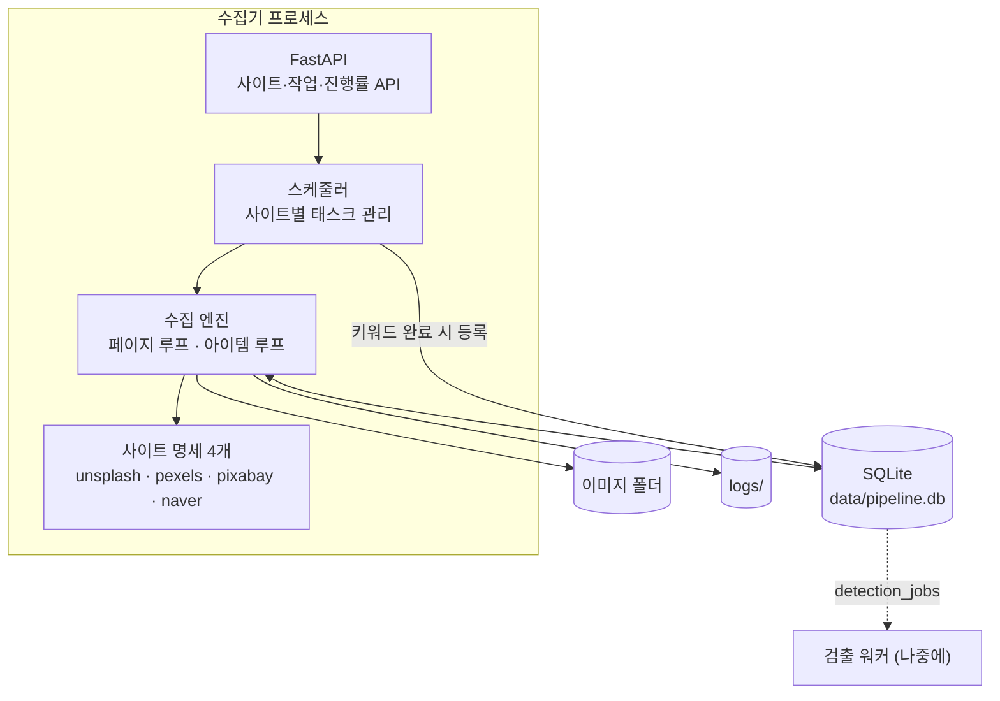
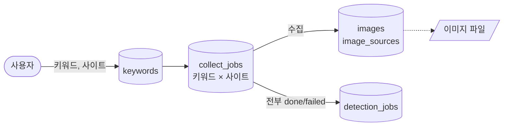
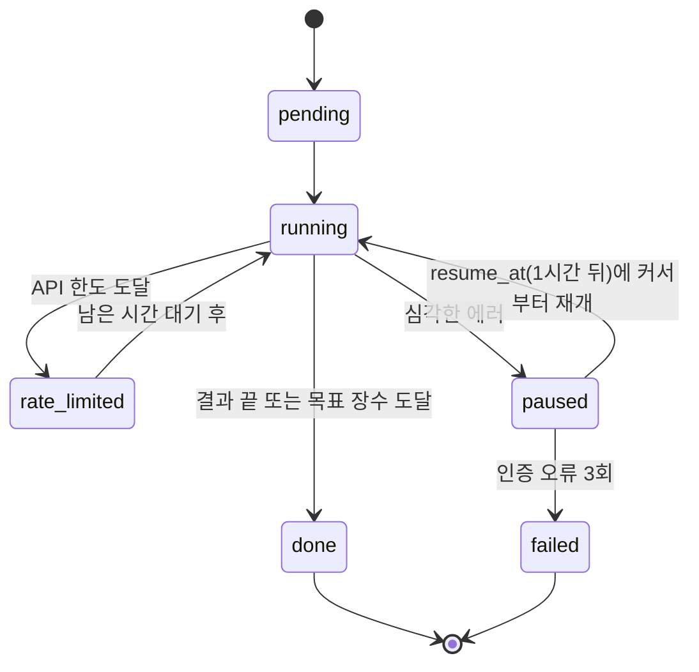
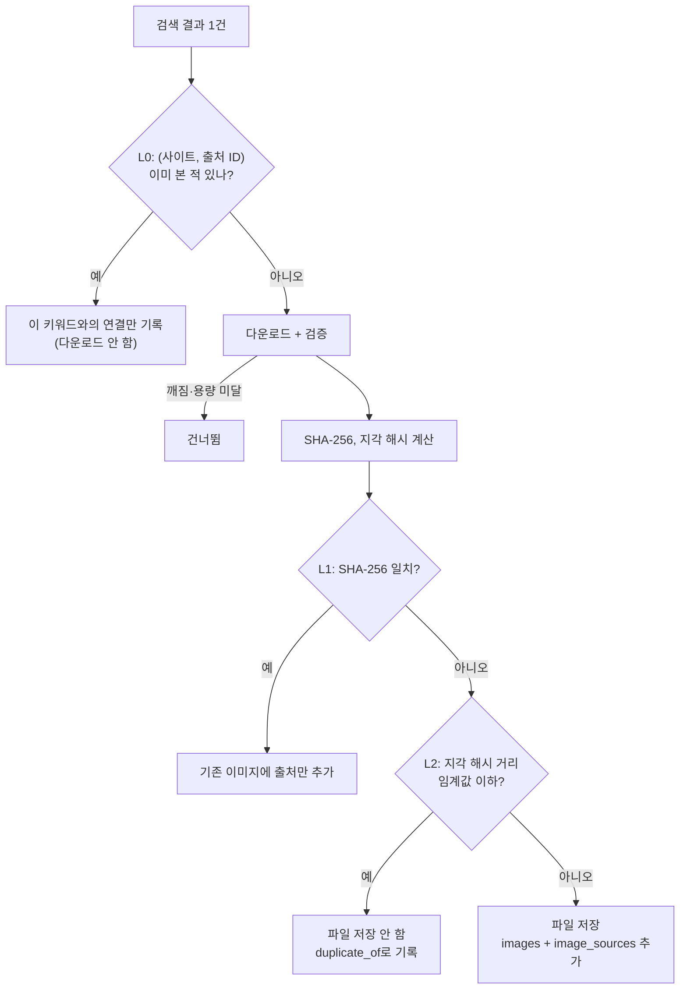
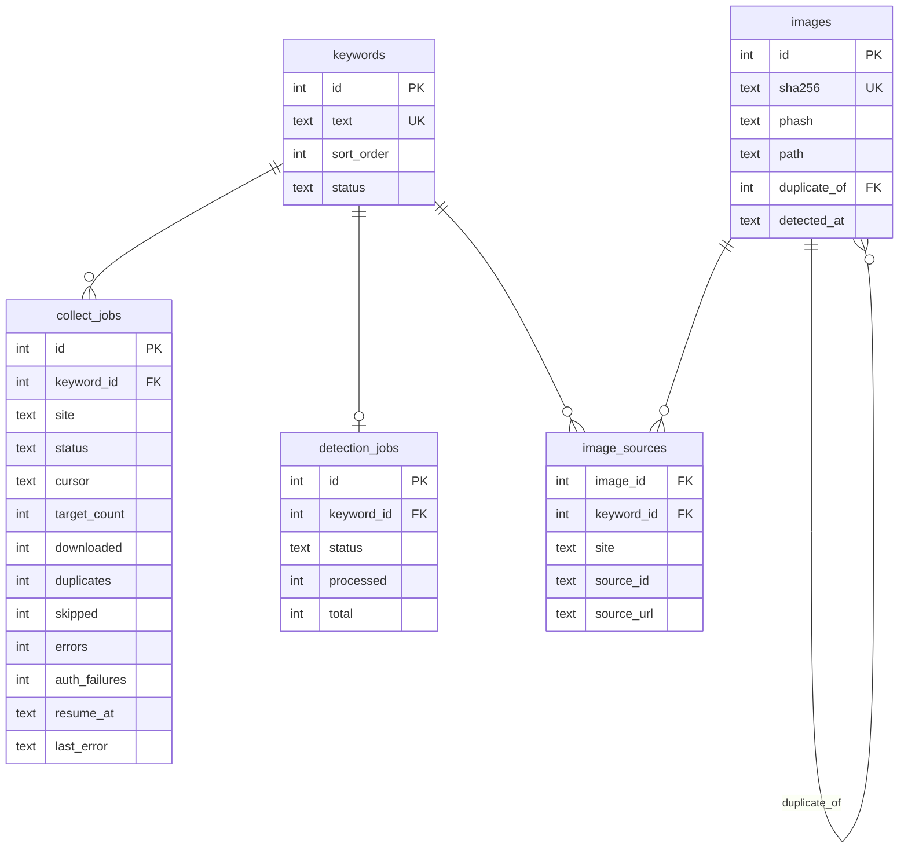

# 이미지 수집 기능 명세

Node로 만들었던 수집기를 Python으로 다시 만들면서 합의한 내용을 정리한 문서입니다.
이전 Node 코드는 git 기록(`554941e` 이전)에 남아 있습니다.
검출·검수 기능은 범위 밖이며, 수집이 검출로 넘겨주는 지점(`detection_jobs`)까지만 다룹니다.

## 1. 전제와 제약

| 항목 | 내용 |
|---|---|
| 실행 환경 | Windows 10, Python 3.12, RAM 부족, RTX 2060 (VRAM 6GB) |
| 운영 방식 | 켜 두면 퇴근 후에도 혼자 수집. 죽었다 켜져도 이어서 진행 |
| 프레임워크 | FastAPI (uvicorn 1개 프로세스) |
| 저장소 | SQLite 파일 1개 (WAL 모드) + 이미지 파일 |
| 프로세스 | 수집기(API 포함) 1개. 검출 워커는 나중에 별도 프로세스로 추가 |
| 화면 | 필요한 최소한만. 빌드 도구 없는 HTML 한 장 또는 `/docs` |

## 2. 기능

| # | 요구사항 | 설계 |
|---|---|---|
| F1 | 수집 사이트 다중 선택 | unsplash, pexels, pixabay, naver 중 선택 |
| F2 | API 연결 확인 | 사이트별로 검색 1건을 요청해 키가 유효한지 확인 |
| F3 | 키워드 여러 개 입력 (`,` 구분) | 입력 순서를 `sort_order`로 저장 |
| F4 | 키워드 순서대로 수집 | **B안**: 사이트마다 자기 속도로 키워드 목록을 순서대로 진행 |
| F5 | 사이트별 진행률 표시 | `collect_jobs`의 카운터와 상태를 조회 |
| F6 | API 한도 도달 시 대기 후 재개 | 시간당 한도의 남은 시간만큼만 대기 |
| F7 | 에러 시 잠시 멈췄다 재시도 | 네트워크 오류, 429, 5xx는 1→2→4→8초 간격으로 재시도 |
| F8 | 심각한 에러 시 1시간 후 재진행 | 해당 사이트×키워드 작업만 1시간 쉬고 저장된 커서부터 재개 |
| F9 | 인증 오류 3회 시 실패 처리 | `auth_failures`가 3이 되면 `failed`. 완료 판정에서는 끝난 것으로 취급 |
| F10 | 중복 없이 수집 | L0(출처 ID) + L1(SHA-256) + L2(지각 해시)를 사이트·키워드 전체에 적용 |
| F11 | 저장 경로 | `{BASE_SAVE_PATH}\{키워드}\{사이트}\{키워드}_{출처ID}.{확장자}` |
| F12 | 키워드 수집 완료 시 검출 자동 시작 | 모든 사이트 작업이 `done` 또는 `failed`가 되면 `detection_jobs`에 등록 |
| F13 | 오류 로그 | 파일 로그(`logs/`) + 작업별 `last_error` |

Node 버전에서 가져오는 것: 재시도 fetch, 시간당 한도 관리, 매직바이트 검증, `.part` 임시파일 후 rename,
로그의 API 키 마스킹, "엔진 + 사이트 명세(spec)" 구조.

## 3. 구조



## 4. 데이터 흐름

### 4-1. 작업 등록에서 검출 인계까지



### 4-2. 사이트×키워드 작업의 상태



네트워크 오류로 인한 짧은 재시도(F7)는 요청 함수 안에서 끝나므로 상태로 저장하지 않습니다.

### 4-3. 사진 한 장의 처리



- L1·L2 검사와 INSERT는 락 하나로 묶습니다. 사이트 4개가 동시에 돌기 때문입니다.
- 커서는 **페이지를 다 처리한 뒤에만** 저장합니다. 중간에 죽으면 그 페이지를 다시 훑지만 L0가 걸러 줍니다.

## 5. 에러 처리 정책

| 상황 | 처리 | 기록 |
|---|---|---|
| 타임아웃, 연결 끊김, 429, 5xx | 1→2→4→8초 간격 재시도 | 로그 |
| 시간당 API 한도 도달 | `rate_limited`, 남은 시간 대기 | `resume_at` |
| 이미지 한 장이 깨짐·차단됨 | 그 장만 건너뜀 | `skipped` 카운터 |
| 재시도 소진, 예상 못한 예외 | `paused`, 1시간 뒤 재개 (횟수 제한 없음) | `last_error`, 로그 |
| 인증 오류 (401/403, 키 오류) | `paused`, 1시간 뒤 재개. 3회째에 `failed` | `auth_failures` |
| 프로세스 종료 (정전, 재부팅) | 재시작 시 `running` 상태였던 작업을 커서부터 재개 | — |

## 6. 데이터 스키마

실제 정의는 [`app/db/schema.sql`](../app/db/schema.sql)에 있습니다.



| 테이블 | 한 행의 의미 | 핵심 제약 |
|---|---|---|
| `keywords` | 사용자가 입력한 키워드 1개 | `text` UNIQUE |
| `collect_jobs` | 키워드 × 사이트 수집 작업 1개 | `(keyword_id, site)` UNIQUE |
| `images` | 고유한 이미지 1장 (또는 L2 중복 기록 1건) | `sha256` UNIQUE, `path`가 없으면 `duplicate_of` 필수 |
| `image_sources` | "이 이미지를 어느 사이트·키워드에서 발견했나" | `(site, source_id, keyword_id)` PK |
| `detection_jobs` | 키워드 1개의 검출 작업 (수집이 등록, 워커가 소비) | `keyword_id` UNIQUE |

"어디까지 했나"를 기록하는 컬럼: `collect_jobs.cursor`(수집 위치), `collect_jobs.status`(완료 여부),
`images.detected_at`(검출 여부, 나중에 워커가 사용).

검출 결과용 `detections`, `crops` 테이블은 검출 단계에서 추가합니다.

## 7. 개발 순서

| 단계 | 상태 | 내용 | 확인한 방법 |
|---|---|---|---|
| 1 | 완료 | 프로젝트 뼈대, SQLite 스키마와 연결 | 스키마 제약 테스트 |
| 2 | 완료 | 설정 로드, HTTP 유틸(재시도·한도·키 마스킹), 이미지 검증·저장·해시 | 가짜 서버 단위 테스트 |
| 3 | 완료 | 수집 엔진, 사이트 명세 4개, 중복 제거 L0·L1·L2 | 가짜 응답으로 수집 테스트 |
| 4 | 완료 | 스케줄러: 사이트별 키워드 진행, 상태 전이, 1시간 재개, 인증 3회 실패, 완료 감지 | 가짜 시계로 상태 전이 테스트 |
| 5 | 완료 | CLI 실행기 + 파일 로그 | 실제 API 4곳에서 소량 수집 |
| 6 | 완료 | FastAPI: 연결 확인, 작업 등록·중단, 진행률 | API 테스트 |
| 7 | 완료 | 진행 화면 (HTML 한 장) | 브라우저에서 등록·진행률 확인 |
| 8 | 남음 | 무인 운영: 자동 재시작 등록, 절전 해제, 하룻밤 실행 | 다음 날 아침 결과 확인 |
| 9 | 완료 | Node 코드 제거 | — |

## 8. 실행 방법

처음 한 번:

```
python -m venv .venv
.venv\Scripts\python -m pip install -e .[dev]
```

| 명령 | 하는 일 |
|---|---|
| `.venv\Scripts\python -m app check` | API 키 4개가 유효한지 확인 |
| `.venv\Scripts\python -m app collect "beach, sunset" --sites pexels,naver --target 50` | 키워드를 등록하고 끝날 때까지 수집 |
| `.venv\Scripts\python -m app resume` | 남은 작업을 이어서 수집 |
| `.venv\Scripts\python -m app status` | 진행 상황 출력 |
| `.venv\Scripts\python -m app serve` | 웹 서버 실행. 화면은 http://127.0.0.1:8000, API 문서는 `/docs` |
| `.venv\Scripts\python -m pytest` | 테스트 |

`collect`의 `--sites`를 빼면 키가 설정된 모든 사이트에서, `--target`을 빼면 `.env`의 `MAX_DOWNLOADS`만큼 받습니다.

## 9. 코드 구조

```
app/
├── __main__.py, cli.py      명령줄 실행기
├── main.py                  FastAPI 앱 (서버 시작 시 스케줄러도 시작)
├── runtime.py               부품 조립 (DB 연결, HTTP 클라이언트, 사이트 명세, 스케줄러)
├── config.py                .env → Settings
├── logging_setup.py         콘솔 + logs/collector.log
├── timeutil.py              UTC 시각 ↔ DB 문자열
├── static/index.html        진행 화면
├── db/
│   ├── schema.sql           테이블 정의
│   ├── connection.py        연결 설정 (WAL 등)
│   └── repo.py              SQL 질의 모음
└── collector/
    ├── scheduler.py         어떤 작업을 언제 돌릴지 (사이트별 태스크, 상태 전이)
    ├── engine.py            작업 하나를 돌리는 방법 (페이지 루프, 아이템 루프, 중복 검사)
    ├── http.py              재시도 GET, 시간당 한도, 키 마스킹, 에러 타입
    ├── images.py            이미지 검사, 해시, 저장
    ├── dedup.py             지각 해시 색인 (L2)
    └── sources/             사이트 명세 (base.py + 사이트 4개)
```

이전 Node 버전과의 대응: `api/lib.js` → `http.py` + `images.py`, `api/collector.js` → `engine.py`,
`api/sources/*.js` → `collector/sources/*.py`, `index.js` → `cli.py`. `scheduler.py`와 `db/`는 새로 생긴 부분입니다.

## 10. 구현하면서 정한 것

- **끝난 키워드를 다시 등록하면** 그 작업을 처음부터 다시 돌립니다. 이미 받은 사진은 L0가 걸러서
  그사이 새로 올라온 사진만 받습니다. 목표 장수는 "이번 실행에서 새로 받을 장수"를 뜻합니다.
  검출 작업도 다시 대기 상태가 되며, 워커는 `detected_at`이 빈 이미지만 처리하면 됩니다.
- **진행 중인 키워드를 다시 등록하면** 기존 작업은 건드리지 않고, 새로 고른 사이트의 작업만 추가합니다.
- **한 작업이 1시간 쉬는 동안** 그 사이트는 다음 키워드로 넘어갑니다. 쉬던 작업은 시간이 되면 이어서 합니다.
- **이미지 다운로드가 5장 연속 실패하면** 네트워크나 사이트 문제로 보고 작업을 1시간 쉽니다.
  그대로 두면 남은 검색 결과를 전부 실패로 흘려보내게 되기 때문입니다.
- **Unsplash의 403**은 본문이 `Rate Limit Exceeded`이면 인증 오류로 세지 않습니다.
- **Pixabay의 400**은 본문에 `API key`가 있으면 인증 오류, 2페이지 이후면 결과 끝으로 봅니다.
- **지각 해시**는 Pillow만으로 구현한 dHash(64비트)입니다. 비교는 저장된 해시 전체를 순서대로 훑습니다.
  수십만 장을 넘겨 느려지면 색인 구조로 바꿉니다.
- **DB 접근**은 연결 하나를 이벤트 루프 스레드에서만 씁니다. 중복 검사부터 저장까지(`engine._store`)에
  `await`가 없어서 별도 잠금 없이도 사이트 간 경쟁이 생기지 않습니다.

## 11. 아직 정하지 않은 것

- L2 지각 해시의 임계값(`PHASH_THRESHOLD`, 기본 5). 실제 수집 데이터에서 `images.duplicate_of`가
  달린 행을 눈으로 확인해 조정해야 합니다.
- 시간당 한도 카운터는 메모리에만 있어서 프로그램을 다시 켜면 0부터 셉니다. 재시작 직후 한도를 넘기면
  사이트가 429/403을 돌려주고, 그 작업은 1시간 쉬었다가 이어집니다.
