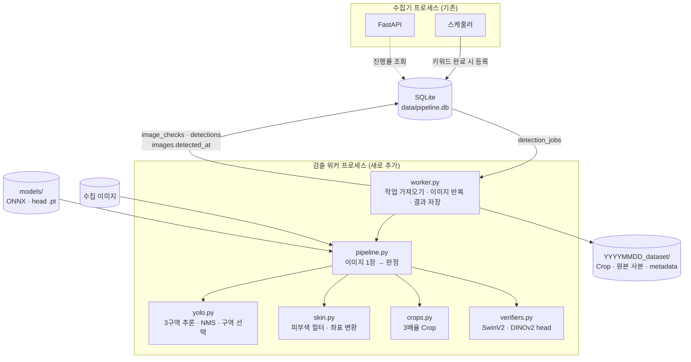
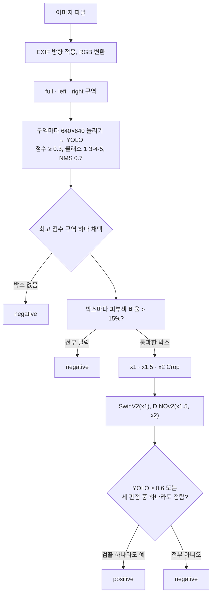
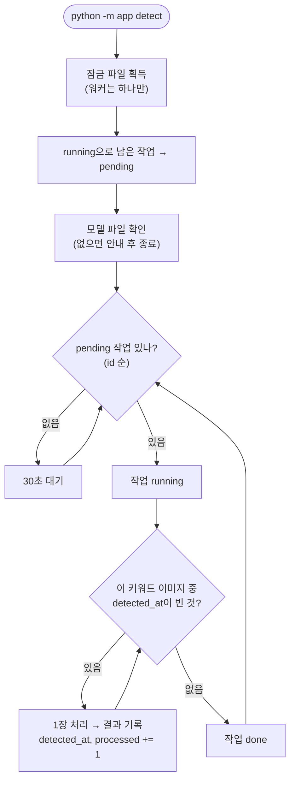

# 이미지 검출 기능 명세 (original 브랜치)

`reference/`의 검출 프로그램(React + Flask, 이하 **reference**)을 이 FastAPI 프로젝트로 옮기면서 정한 내용을 정리한 문서입니다.

`original` 브랜치의 목표는 **reference의 검출 방법과 판정 결과를 그대로 재현하는 것**입니다.
알려진 약점도 이 브랜치에서는 고치지 않습니다. 나중에 개선 브랜치를 만들면, 이 브랜치의 결과를 비교 기준으로 씁니다.

## 1. 전제와 제약

| 항목 | 내용 |
|---|---|
| 목적 | 모델이 이미지마다 자동으로 판정. 사람 검수 기능은 나중에 추가 |
| 입력 | 수집기가 모은 이미지 (`images` 테이블). 수집기가 `detection_jobs`에 등록한 키워드 단위로 처리 |
| 실행 환경 | Windows 10, Python 3.12, RAM 8GB, RTX 2060 (VRAM 6GB), i5-10400F |
| 프로세스 | 수집기(FastAPI)와 분리된 **검출 워커 프로세스** 1개. 두 프로세스는 SQLite(WAL)로만 연결 |
| 모델 | YOLOv8n ONNX(`best_640n_0522.onnx`, Ultralytics 8.0.196), SwinV2-large·DINOv2-large 백본 + 클래스별 linear head |
| 범위 밖 | OpenCLIP 분류기(reference에서도 호출되지 않음), head 재학습, 사람 검수 화면 |

검출 워커를 따로 두는 이유는 세 가지입니다.

- torch와 백본 두 개가 RAM과 VRAM을 수 GB 차지합니다. 수집기와 수명을 분리해야 서로 영향을 덜 줍니다.
- 모델 추론은 CPU·GPU를 오래 붙잡는 동기 작업입니다. 수집기의 이벤트 루프 안에서 돌리면 수집과 API가 멈춥니다.
- 워커가 메모리 부족 등으로 죽어도 수집은 계속됩니다.

## 2. reference에서 그대로 가져오는 것

아래 값과 동작은 **바꾸지 않습니다.** 출처는 `reference/src/App.tsx`와 `reference/server/app.py`입니다.

| # | 단계 | 동작 | 값 |
|---|---|---|---|
| R1 | 이미지 로드 | EXIF 방향을 적용하고 RGB로 변환 | — |
| R2 | 구역 나누기 | 전체(full), 왼쪽 절반(left), 오른쪽 절반(right) | 폭 `W/2` 기준 |
| R3 | YOLO 전처리 | 구역을 **비율을 무시하고** 640×640으로 늘림 → `/255` → `[1,3,640,640]` float32 (NCHW, RGB) | 640 |
| R4 | YOLO 출력 해석 | 박스마다 `cx,cy,w,h` + 클래스 6개 점수. 가장 높은 클래스를 그 박스의 클래스로 봄 | — |
| R5 | 1차 필터 | 점수 ≥ 0.3, 클래스 ∈ {1,3,4,5} | 0.3 |
| R6 | NMS | 점수 내림차순으로, **같은 클래스끼리** IoU ≥ 0.7이면 제거 | 0.7 |
| R7 | 구역 선택 | 구역별 최고 점수를 비교해 가장 높은 구역 **하나만** 채택. 점수가 같으면 full → left → right 순으로 앞의 구역 | — |
| R8 | 피부색 필터 | 박스 안 픽셀을 YCbCr로 바꿔 `133≤Cr≤173`, `77≤Cb≤127`인 비율이 15%를 **넘어야** 통과 | 0.15 |
| R9 | 좌표 변환 | 구역 좌표를 `floor`/`ceil` 후 구역 크기로 자르고, offset을 더해 반올림 | — |
| R10 | Crop | 박스 중심을 고정하고 가로·세로를 1배, 1.5배, 2배로 넓혀 자름. 이미지 밖은 경계에서 자름 | x1, x1.5, x2 |
| R11 | 2차 검증 | SwinV2 ← x1 Crop, DINOv2 ← x1.5와 x2 Crop. 특징 표준화 → Linear → softmax[1] ≥ 클래스별 threshold | 아래 표 |
| R12 | 최종 판정 | 아래 4조건 중 **하나라도** 참이면 그 검출은 양성(positive) | YOLO 0.6 |
| R13 | Crop 저장 | 저장 옵션이 켜져 있고 양성인 검출만 3배율로 저장. 원본은 이미지당 한 번 저장 | 저장 위치는 3장 참고 |

R12의 4조건은 다음과 같습니다.

1. YOLO 점수 ≥ 0.6
2. SwinV2(x1) 정탐
3. DINOv2(x1.5) 정탐
4. DINOv2(x2) 정탐

**이미지의 판정**은 양성인 검출이 하나라도 있으면 `positive`, 없으면 `negative`입니다.
reference에서 4조건은 "검수 폴더에 저장할 후보"를 고르는 기준이었습니다. 이 브랜치에서는 이 기준을 그대로 자동 판정 기준으로 씁니다.

사용하는 head는 reference 서버가 쓰던 run과 같습니다.

| 클래스 | SwinV2 `run_20260915_161151` | DINOv2 `run_20260915_163347` |
|---|---|---|
| 1 · EXPOSED_BREAST_F | 0.16 | 0.07 |
| 3 · EXPOSED_BUTTOCKS | 0.21 | 0.12 |
| 4 · EXPOSED_GENITALIA_F | 0.56 | 0.70 |
| 5 · EXPOSED_GENITALIA_M | 0.05 | 0.05 |

## 3. reference와 달라지는 것 (실행 환경만)

판정 로직은 같습니다. 바뀌는 것은 **어디서, 무엇으로 실행하는지**뿐입니다.

| 항목 | reference | original 브랜치 | 결과에 주는 영향 |
|---|---|---|---|
| YOLO 실행 | 브라우저, onnxruntime-web (WASM) | 워커, onnxruntime (CPU) | 같은 모델이라 실수 오차 수준 |
| 640 리사이즈 | Canvas `drawImage` | Chrome 방식을 흉내 낸 밉맵 + bilinear (`yolo.resize_like_canvas`) | YOLO 점수 차이 평균 0.009 (9-2) |
| 피부색 분석 | Canvas 픽셀 | NumPy 배열 | 같은 식이라 동일 |
| 브라우저 ↔ 서버 | multipart POST `/api/collect` | 같은 프로세스 안의 함수 호출 | 없음 |
| 입력 | 사용자가 고른 폴더 | DB의 `images` (`detected_at`이 빈 것) | 없음 |
| 결과 기록 | `metadata.jsonl` | SQLite `image_checks`, `detections` | 없음 |
| Crop 미리보기 | base64로 응답 | 만들지 않음 | 없음 |
| 저장 옵션 | 화면 체크박스 (기본 꺼짐) | `.env`의 `DETECT_SAVE_CROPS` (기본 켜짐) | 없음 |
| 저장 폴더 | `server/dataset/` 하나에 계속 쌓음 | 검출한 날짜별 `YYYYMMDD_dataset/` (5-3) | 없음. 파일 이름은 같고 `review_pending` 폴더 단계만 없음 |

## 4. 구조



### 4-1. 코드 구조

```
app/detector/
├── __init__.py
├── yolo.py          ← App.tsx: preprocessSection, runDetection, calculateIoU, applyNms, findBestCandidate
├── skin.py          ← App.tsx: performSkinAnalysis, filterBySkinAndConvertCoordinates
├── crops.py         ← app.py: crop_detection, safe_stem, 파일 이름 규칙
├── verifiers.py     ← pipelines/{swinv2,dinov2}/verifier.py + common.py의 BinaryLinearHead, pool_output
├── pipeline.py      ← App.tsx collect() 루프 + app.py collect()의 판정 부분 (DB·파일 없이 순수 계산)
└── worker.py        새로 작성: detection_jobs 처리, DB 기록, 파일 저장, 에러 처리
models/              (git에 올리지 않음)
├── yolo/best_640n_0522.onnx
├── swinv2/run_20260915_161151/class{1,3,4,5}_head.pt
└── dinov2/run_20260915_163347/class{1,3,4,5}_head.pt
```

- SwinV2와 DINOv2 verifier는 거의 같은 코드입니다. 다른 점은 백본 이름, 특징을 꺼내는 방법(SwinV2는 토큰 평균, DINOv2는 CLS 토큰), 허용하는 `inputScale` 세 가지뿐입니다. 그래서 클래스 하나로 합치고 이 셋을 인자로 받습니다.
- `pipeline.py`는 DB와 파일을 모르는 순수 함수로 둡니다. 덕분에 테스트하기 쉽고, 5-1의 비교 검증에도 그대로 씁니다.
- 학습용 함수(`extract_or_load_features`, `select_threshold` 등)는 옮기지 않습니다.

### 4-2. 이미지 1장의 처리



## 5. 검출 워커

### 5-1. 작업 흐름



- 이미지 1장의 결과(`image_checks`, `detections`, `detected_at`, `processed`)는 **한 트랜잭션**으로 기록합니다. 중간에 죽어도 `detected_at`이 빈 이미지부터 다시 하면 됩니다.
- 같은 이미지가 여러 키워드에 걸려 있으면 처음 한 번만 검출합니다. 이미 `detected_at`이 있으면 다른 키워드 작업에서는 건너뜁니다.
- 백본은 처음 쓸 때 한 번 올리고(reference와 같은 lazy loading), 워커가 끝날 때까지 재사용합니다.
- 워커 잠금은 수집기 잠금과 다른 파일(`pipeline.db.detect.lock`)을 씁니다. 그래서 수집기와 워커는 동시에 돌 수 있고, 워커끼리는 하나만 돕니다.

### 5-2. 에러 처리

| 상황 | 처리 | 기록 |
|---|---|---|
| 이미지 파일이 없거나 깨짐 | 그 장만 `error`로 기록하고 다음 장으로 | `image_checks.error`, 로그 |
| 모델 파일 없음, 백본 다운로드 실패 | 워커를 시작하지 않고 안내 | 로그 |
| 예상 못한 예외 (GPU 메모리 부족 등) | 그 장은 `error`. **5장 연속**이면 작업을 pending으로 되돌리고 10분 쉰 뒤 재개 | 로그 |
| 프로세스 종료 | 재시작 시 `running` 작업을 `pending`으로 되돌리고 이어서 처리 | — |

`error`로 기록한 이미지도 `detected_at`을 채웁니다. 그래야 같은 이미지에서 무한히 실패하지 않습니다. 다시 검출하려면 `detected_at`을 비우면 됩니다.

### 5-3. 결과 파일

`DETECT_SAVE_CROPS=true`이고 양성 검출이 있을 때만 저장합니다.
결과는 팀원에게 파일로 보내기 때문에, **검출한 날짜별 폴더**(`YYYYMMDD_dataset`)로 나눠 저장합니다.
파일 이름 규칙은 reference와 같습니다. 폴더 구조는 reference의 `class{N}\review_pending\`에서 `review_pending` 단계를 빼고, Crop을 `class{N}\` 바로 아래에 둡니다. 날짜 폴더 하나만 압축하면 그날 결과를 그대로 보낼 수 있습니다.

```
{DETECT_SAVE_PATH}\
├── 20261015_dataset\
│   ├── detect_img\          원본 사본
│   ├── class1\
│   ├── class3\
│   ├── class4\
│   ├── class5\
│   └── metadata.jsonl       팀원에게 함께 보낼 기록
└── 20261016_dataset\
```

| 위치 | 파일 이름 | 개수 |
|---|---|---|
| `detect_img\` | `{원본명}__detected__{8자리}.{확장자}` | 양성 이미지 1장당 1개 |
| `class{N}\` | `{원본명}__det{번호}__class{N}__{x1·x1.5·x2}__yolo{점수}__{그룹ID}.jpg` | 양성 검출 1건당 3개 (같은 그룹 ID) |
| `metadata.jsonl` | — | 양성 검출 1건 = 1줄 |

- 클래스 폴더는 그날 해당 클래스의 양성 검출이 있을 때만 만듭니다. 빈 폴더는 만들지 않습니다.

- **날짜 기준**은 수집한 날이 아니라 **검출한 날**이고, PC의 현지 시각(한국 시간)을 씁니다. DB 시각은 UTC로 저장하지만, 폴더 이름은 사람이 보고 고르는 것이라 현지 날짜가 맞습니다.
- 이미지 1장의 파일(원본 사본과 Crop)은 **같은 날짜 폴더**에 넣습니다. 처리 시작 시각으로 날짜를 정하므로, 자정 직전에 처리를 시작한 이미지가 두 폴더로 갈라지지 않습니다.
- 작업이 자정을 넘기면 그 뒤에 처리한 이미지는 다음 날 폴더로 갑니다.
- **`metadata.jsonl`**을 날짜 폴더마다 둡니다. 팀원은 DB를 볼 수 없으므로, 좌표·점수·판정 사유를 파일로 함께 보내기 위해서입니다. 형식은 reference의 metadata에서 Crop 미리보기(base64)를 뺀 것과 같고, 경로는 날짜 폴더 기준 상대 경로로 적습니다. DB가 원본 기록이고, 이 파일은 보내기용 사본입니다.

## 6. 데이터 스키마 추가

스키마 버전을 3에서 4로 올립니다. 기존 테이블은 바꾸지 않고 테이블 두 개만 추가합니다.

```sql
-- 이미지 1장의 검출 요약. 다시 검출하면 덮어쓴다.
CREATE TABLE IF NOT EXISTS image_checks (
    image_id      INTEGER PRIMARY KEY REFERENCES images(id) ON DELETE CASCADE,
    pipeline      TEXT    NOT NULL,              -- 'original'. 개선 브랜치 결과와 구분하는 이름
    verdict       TEXT    NOT NULL CHECK (verdict IN ('positive', 'negative', 'error')),
    section       TEXT    CHECK (section IN ('full', 'left', 'right')),  -- 채택한 구역
    yolo_boxes    INTEGER NOT NULL DEFAULT 0,    -- 채택 구역의 박스 수 (NMS 후)
    skin_passed   INTEGER NOT NULL DEFAULT 0,    -- 피부색 필터 통과 수 = detections 행 수
    dataset_dir   TEXT,                          -- 결과 파일을 저장한 날짜 폴더 이름 (예: 20261015_dataset). 저장 안 했으면 NULL
    original_copy TEXT,                          -- 원본 사본 경로 (날짜 폴더 기준 상대 경로)
    error         TEXT,
    elapsed_ms    INTEGER,
    checked_at    TEXT    NOT NULL DEFAULT (datetime('now'))
);

-- 피부색 필터를 통과한 검출 1건 = 1행
CREATE TABLE IF NOT EXISTS detections (
    id              INTEGER PRIMARY KEY,
    image_id        INTEGER NOT NULL REFERENCES images(id) ON DELETE CASCADE,
    det_index       INTEGER NOT NULL,            -- 이미지 안에서의 순번 (0부터)
    class_id        INTEGER NOT NULL CHECK (class_id IN (1, 3, 4, 5)),
    yolo_conf       REAL    NOT NULL,
    x1 INTEGER NOT NULL, y1 INTEGER NOT NULL, x2 INTEGER NOT NULL, y2 INTEGER NOT NULL,  -- 원본 좌표
    swinv2_score    REAL    NOT NULL,            -- x1 Crop
    dinov2_x15_score REAL   NOT NULL,            -- x1.5 Crop
    dinov2_x2_score REAL    NOT NULL,            -- x2 Crop
    reasons         TEXT    NOT NULL,            -- 참인 조건 목록 (JSON 배열). 비어 있으면 음성
    positive        INTEGER NOT NULL CHECK (positive IN (0, 1)),
    crop_group      TEXT,                        -- 저장한 Crop 3장의 그룹 ID
    UNIQUE (image_id, det_index)
);
CREATE INDEX IF NOT EXISTS idx_detections_image ON detections (image_id);
```

- 각 모델의 판정 여부(정탐/오탐)는 저장하지 않고 **점수**만 저장합니다. threshold는 head 파일에 있어서 판정은 언제든 다시 계산할 수 있고, 기준을 바꿔 볼 때 다시 검출하지 않아도 됩니다. `reasons`는 그 당시 판정 결과를 바로 보기 위해 남깁니다.
- 피부색 필터에서 떨어진 박스는 reference처럼 기록하지 않고 개수만 남깁니다(`yolo_boxes − skin_passed`).

## 7. 설정 (.env 추가 항목)

| 항목 | 설명 | 기본값 |
|---|---|---|
| `MODEL_DIR` | 모델 폴더 | 프로젝트의 `models` |
| `DETECT_SAVE_CROPS` | 양성 검출의 Crop, 원본 사본, metadata 저장. 결과를 팀원에게 보내야 하므로 기본으로 켬 | `true` |
| `DETECT_SAVE_PATH` | 날짜 폴더(`YYYYMMDD_dataset`)를 만들 상위 폴더 | 프로젝트의 `detect` |
| `DETECT_DEVICE` | 백본 실행 장치 `auto`·`cuda`·`cpu` | `auto` |
| `HF_HOME` | Hugging Face 백본 캐시 위치 (약 2GB). C 드라이브가 좁으면 옮김 | 사용자 폴더 |

YOLO 기준값(0.3, 0.7, 0.6, 피부 0.15)은 `.env`로 빼지 않고 코드 상수로 둡니다. 이 브랜치는 reference와 같은 값으로 고정하는 것이 목적이기 때문입니다.

## 8. 의존성

수집기만 쓰는 PC에 무거운 패키지를 깔지 않도록 선택 설치로 분리합니다.

```toml
[project.optional-dependencies]
detect = ["numpy", "onnxruntime", "torch", "torchvision", "transformers", "safetensors"]
```

GPU용 torch는 PyPI 기본 패키지가 아니라 PyTorch 인덱스에서 받아야 합니다. 그래서 torch와 torchvision을 먼저 설치합니다.

```
.venv\Scripts\python -m pip install torch torchvision --index-url https://download.pytorch.org/whl/cu128
.venv\Scripts\python -m pip install -e .[dev,detect]
```

이 PC(드라이버 CUDA 13.4)에서는 torch 2.11.0+cu128, torchvision 0.26.0, transformers 5.19.0, onnxruntime 1.31.0으로 확인했습니다.
reference는 torch 2.13.0을 썼지만 cu128 인덱스에는 2.11이 최신이었습니다. 버전 차이가 점수에 주는 영향은 9-2 비교에서 함께 드러납니다.

## 9. 검증 방법

### 9-1. 단위 테스트 (모델 없이)

IoU·NMS, YOLO 출력 해석(가짜 텐서), 구역 선택과 동점 규칙, 피부색 판정, 좌표 변환, Crop 범위 계산, 4조건 판정, DB 기록, 재시작 복구를 테스트합니다.
실제 모델을 쓰는 테스트에는 `models` 표시를 붙여, 모델 파일이 없으면 건너뜁니다.

### 9-2. reference와의 동등성 비교

이 브랜치의 핵심 검증입니다. 같은 이미지 묶음을 reference와 이식 버전에 각각 넣고 결과를 비교합니다.

1. 샘플 묶음을 정합니다. `used_img`에서 50장, 수집 이미지(`F:\Images`)에서 100장을 시드 `20261015`로 뽑아 `data/compare/sample/`에 둡니다.
2. reference를 실행해 결과를 받습니다. `reference/`는 그대로 두고 **비교용 사본** `data/compare/reference_app/`을 만들어 고칩니다. 고친 곳은 `[COMPARE]` 표시가 있는 부분뿐이고 판정 로직은 건드리지 않습니다.
   - 서버(5001번 포트. 5000번은 다른 프로그램이 쓰고 있음): 샘플 파일을 내려주고, 브라우저가 보낸 이미지별 결과를 `data/compare/reference.jsonl`에 기록
   - 화면: `http://localhost:5173/#compare`로 열면 샘플을 받아 자동으로 처리. 폴더 선택이 필요 없습니다.
   - 이미지 사이의 `requestAnimationFrame` 대기를 `setTimeout`으로 바꿈. 브라우저 창이 가려지면 멈추기 때문입니다. 결과에는 영향이 없습니다.
   - 같은 가상환경(`.venv`)에서 돌려 torch·transformers 버전 차이를 없앴습니다. 그래서 이 비교는 **이식 코드의 차이만** 봅니다.
   - 실행 설정은 `.claude/launch.json`의 `compare-ref-server`, `compare-ref-web`입니다.
3. 이식 버전으로 같은 묶음을 처리합니다: `python -m app detect-one data/compare/sample --json > data/compare/ported.jsonl`
4. 이미지별로 비교합니다: `python scripts/compare_reference.py data/compare/reference.jsonl data/compare/ported.jsonl`
   이미지 판정, 채택 구역, 검출 개수, 박스 좌표, YOLO 점수, head 점수 3개를 봅니다.

| 비교 항목 | 목표 |
|---|---|
| 이미지 판정(positive/negative) 일치율 | 98% 이상 |
| 같은 검출의 YOLO 점수 차이 | 평균 0.02 이하 |
| 같은 검출의 head 점수 차이 | 평균 0.02 이하 |

#### 비교 결과 (2026-10-15, 샘플 150장: reference 양성 58장, 음성 92장)

| 비교 항목 | 목표 | 1차 (Pillow BILINEAR) | 2차 (밉맵 + bilinear) |
|---|---|---|---|
| 이미지 판정 일치율 | 98% 이상 | 95.3% (143/150) | **98.7% (148/150)** |
| 채택 구역 일치 | — | 147/150 | 149/150 |
| 검출 개수 일치 | — | 142/150 | 148/150 |
| 박스 IoU 평균 | — | 0.979 | 0.992 |
| YOLO 점수 차이 평균 (최대) | 0.02 이하 | 0.025 (0.237) | **0.009 (0.050)** |
| SwinV2 점수 차이 평균 | 0.02 이하 | 0.013 | **0.008** |
| DINOv2 x1.5 · x2 점수 차이 평균 | 0.02 이하 | 0.012 · 0.012 | **0.008 · 0.009** |

2차에서 목표를 모두 넘었습니다. 남은 불일치 2장은 모두 기준값 바로 옆에서 갈린 경우입니다.

- `bikinis_IMStenMyG4M.jpg`: YOLO 0.5995(reference) ↔ 0.6025(이식). 0.6 기준을 사이에 두고 판정이 갈림
- `bodybuilder_woman_14983372…jpg`: reference YOLO 0.3021 → 이식은 0.3 미만이라 박스 자체가 없음

**1차에서 2차로 바꾼 것.** 1차의 불일치 7장도 모두 YOLO 점수가 0.6 근처인 경우였습니다. 원인을 찾으려고 브라우저 Canvas가 실제로 만든 640×640 픽셀(6장 × 3구역)을 받아 여러 리사이즈 방식과 비교했습니다.

| 리사이즈 방식 | 픽셀 평균 오차 | YOLO 최고점 차이 평균 |
|---|---|---|
| 이미지 전체 밉맵, 단계 = 덜 줄어드는 쪽 배율, 이후 bilinear | **1.14** | **0.007** |
| Pillow BICUBIC | 1.40 | 0.021 |
| bilinear (안티앨리어싱 없음) | 1.47 | 0.049 |
| Pillow BILINEAR (1차) | 1.56 | 0.043 |
| Pillow BOX | 1.66 | 0.022 |
| Pillow NEAREST | 2.52 | 0.103 |

Chrome은 이미지를 크게 줄일 때 절반씩 줄인 사본(밉맵)을 미리 만들어 두고, 알맞은 단계에서 bilinear로 읽습니다. 이 동작을 흉내 낸 방식이 가장 가까워서 이것으로 바꿨습니다.
남은 픽셀 오차(약 1)는 브라우저와 Pillow의 JPEG 디코더 차이로 보입니다. 이 부분은 더 맞추기 어렵습니다.

같은 가상환경에서 두 쪽을 돌렸기 때문에, head 점수의 작은 차이(평균 0.008)는 Crop 좌표가 1~2픽셀 달라서 생긴 것입니다.

## 10. 개발 순서

한 단계가 끝날 때마다 "확인한 방법"까지 마치고 커밋합니다.

| 단계 | 상태 | 내용 | 확인한 방법 |
|---|---|---|---|
| 0 | 완료 | 준비: `models/` 배치·`.gitignore`, `detect` 선택 의존성, GPU용 torch 설치 | torch 2.11+cu128에서 CUDA 동작, ONNX 입력 `[1,3,640,640]`·출력 `[1,10,8400]` 확인 |
| 1 | 완료 | `yolo.py`: 3구역 전처리, ONNX 추론, 출력 해석, NMS, 구역 선택 | 단위 테스트 + 샘플 이미지 박스 출력 |
| 2 | 완료 | `skin.py`, `crops.py`: 피부색 필터, 좌표 변환, 3배율 Crop | 단위 테스트 |
| 3 | 완료 | `verifiers.py`: head 로드, 백본 lazy 로딩, 점수 계산 | head 로드 테스트. 측정: VRAM 약 2GB, 프로세스 RAM 약 1.25GB, 검출 1건당 약 130ms (RTX 2060) |
| 4 | 완료 | `pipeline.py` 조립, 이미지 1장 디버그 명령 `python -m app detect-one <파일>`, 리사이즈를 Canvas 방식으로 맞춤 | 9-2 동등성 비교: 판정 일치 98.7%, YOLO 점수 차이 평균 0.009 |
| 5 | 대기 | 스키마 v4, repo 함수, `worker.py`(작업 루프·재시작 복구·에러 정책), 잠금 | DB·워커 단위 테스트 (가짜 파이프라인) |
| 6 | 대기 | 날짜 폴더(`YYYYMMDD_dataset`)에 결과 파일·metadata 저장, `python -m app detect` 명령 | 날짜 계산 단위 테스트(자정 경계 포함) + 실제 키워드 1개 처리 후 DB·폴더 확인 |
| 7 | 대기 | 진행 화면과 `/api/progress`에 검출 진행률·양성 수 추가 | 브라우저에서 수집 → 검출 진행 확인 |
| 8 | 대기 | 무인 운영: 자동 시작 스크립트에 워커 추가, 수집기와 동시 실행 | 하룻밤 실행, 메모리 사용량 확인 |
| 9 | 대기 | README, 이 문서 정리 | — |

1~4단계는 DB 없이 이미지 → 판정만 다룹니다. 판정이 reference와 같다는 것을 먼저 확인한 다음에 워커를 붙이는 순서입니다. 판정이 틀린 상태로 워커부터 만들면, 나중에 틀린 이유가 로직인지 저장 과정인지 가리기 어렵기 때문입니다.

## 11. 알려진 한계 (이 브랜치에서는 고치지 않음)

reference를 그대로 재현하기 때문에 아래 문제도 그대로 남습니다. 개선 브랜치에서 다룰 후보입니다.

- **리사이즈 방식:** 모델은 Ultralytics(letterbox 학습)로 만들어졌는데, 추론은 비율을 무시하고 늘려서 합니다.
- **구역 선택:** 3구역 중 한 구역 결과만 쓰기 때문에, 다른 구역에만 있는 검출은 버려집니다.
- **판정 기준이 재현율 우선:** 4조건을 OR로 묶고 threshold도 낮습니다(0.05 등). 사람이 거른다는 전제로 만든 기준이라 자동 판정에서는 오탐이 많을 수 있습니다.
- **피부색 필터:** 흑백 사진, 특이한 조명, 범위 밖의 피부톤에서는 실제 대상을 놓칠 수 있습니다.
- **라이선스:** YOLO 모델은 Ultralytics(AGPL-3.0)로 학습·내보낸 것입니다. 사내 배포 형태에 따라 라이선스 검토가 필요할 수 있습니다. 법적 판단은 확실하지 않으니 담당 부서에 확인해야 합니다.

## 12. 아직 정하지 않은 것

- 9-2 동등성 비교의 목표 수치와 샘플 묶음 크기
- 원래 reference가 돌던 환경(Python 3.11, torch 2.13, transformers 버전 모름)과의 차이. 9-2 비교는 양쪽을 같은 가상환경에서 돌려 **이식 코드의 차이만** 확인했습니다. 원래 환경에서 head 점수가 같았는지는 확실하지 않습니다. 확인하려면 원래 환경의 transformers 버전이 필요합니다. 현재 전처리기는 SwinV2가 `ViTImageProcessor`, DINOv2가 `BitImageProcessor`입니다.
